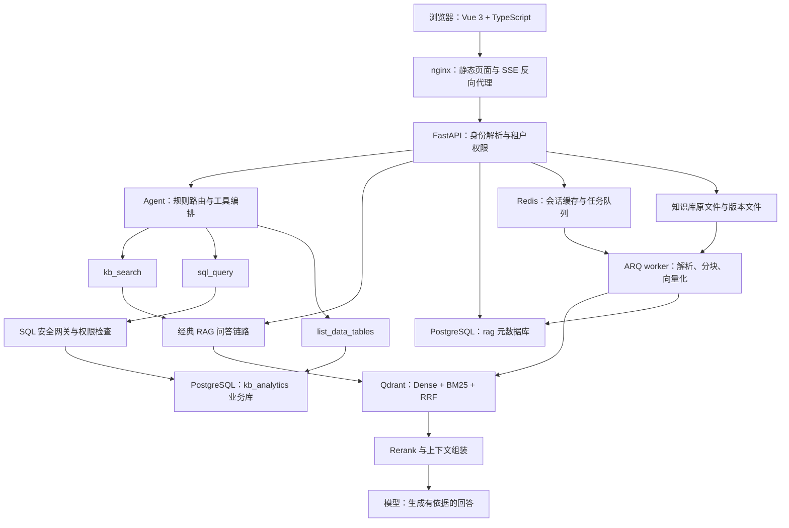

# 企业知识库问答 Agent：RAG + Text2SQL 双引擎

面向企业内部文档与业务数据的多租户问答助手。政策、合同、规格与操作流程通过 RAG 检索回答；人数、金额、排名等全量统计通过只读 SQL 计算；需要两类信息的问题由 Agent 调用工具联合回答。

项目覆盖 Vue 前端、FastAPI API、异步入库 worker、会话持久化、文档版本管理、数据权限、评测和部署。定位为可演示、可测试的工程实践项目，目前适合受控内部试点，尚未完成生产质量与容量验收。

**技术栈：** Python 3.12+ · FastAPI · Vue 3 · TypeScript · Pinia · PostgreSQL · Qdrant · Redis · ARQ · SQLAlchemy · Alembic · sqlglot · Docker Compose · nginx

默认模型配置为 DeepSeek-V3.2、BGE-M3 和 BGE Reranker，通过 SiliconFlow 调用；实际模型以运行配置为准。

## 快速了解

| 关注点 | 项目实现 | 代码或证据 |
| --- | --- | --- |
| 检索质量 | Dense + BM25 双通道召回、RRF 融合、交叉编码器重排、按分数量纲过滤 | [向量检索](backend/app/vector/qdrant.py) |
| 精确统计 | Schema 语义信息、示例检索、NL→SQL、错误反馈重写、只读执行 | [Text2SQL](backend/app/analytics/text2sql.py) |
| Agent 可控性 | 规则前置路由、三个工具、请求独立状态、步数与调用预算、重复调用检测 | [Agent Loop](backend/app/agent/loop.py) |
| 数据安全 | 统一租户 ACL、PostgreSQL RLS、独立 SQL 账号、列级授权、结果脱敏与审计 | [权限实现](backend/app/analytics/permissions.py) |
| 文档生命周期 | 异步入库、同名版本链、完整写入后发布、历史版本隐藏、回滚与删除 | [版本化入库说明](docs/版本化入库.md) |
| 用户体验 | SSE 问答、来源引用、SQL 与工具执行轨迹、上传进度、版本切换 | [前端组件](frontend/src/components/) |
| 工程验证 | 冻结检索基线、逐题回归、权限/并发测试、答案质量与性能评测工具 | [评测目录](backend/eval/) |

**历史检索基线：** 107 道题中 101 道参与来源召回判定，Recall@5 为 **99.01%**，MRR 为 **0.9703**。这是检索结果，不是最终答案正确率。详细口径见下文“评测与验证”。

## 目录

- [业务问题与关键案例](#业务问题与关键案例)
- [系统架构与请求链路](#系统架构与请求链路)
- [核心设计与工程亮点](#核心设计与工程亮点)
- [功能边界](#功能边界)
- [评测与验证](#评测与验证)
- [启动与演示](#启动与演示)
- [API 与代码导航](#api-与代码导航)
- [当前限制与后续计划](#当前限制与后续计划)
- [简历描述参考](#简历描述参考)
- [设计与验收文档](#设计与验收文档)

## 业务问题与关键案例

企业知识问答包含不同类型的问题：

| 问题示例 | 所需能力 | 处理方式 |
| --- | --- | --- |
| “路由器整机质保多久？” | 从合同或政策中寻找条款 | RAG 检索文档并给出引用 |
| “Sales 和 Engineering 部门各有多少人，相差多少？” | 对全量员工记录分组计数 | Text2SQL 交给数据库计算 |
| “实际业务指标是否符合制度规定？” | 同时获得制度依据和统计结果 | Agent 组合文档检索与数据查询 |
| “平均客单价是多少？” | 先确定统计口径 | 澄清指标定义后再查询 |

### 为什么加入 Text2SQL

原有纯 RAG 链路在一例部门人数对比中暴露了“相关片段不等于完整数据”的问题：

| 指标 | 原 RAG 回答 | 数据库真值 |
| --- | --- | --- |
| Sales 人数 | 1042 | 1042 |
| Engineering 人数 | 25 | 1010 |
| 两部门差值 | 1017 | 32 |

这是一例历史问题复现，不能据此推导全部问题的错误率。其工程意义在于：万行表格切成多个片段后，即使召回片段高度相关，也无法证明覆盖了所有满足条件的记录。增加 top_k 或预生成少量摘要，仍无法覆盖任意筛选与分组组合。

因此，项目把**检索相关证据**与**全量精确计算**分配给不同工具。示例 SQL 为：

```sql
SELECT department, COUNT(*) AS headcount
FROM employees
WHERE department IN ('Sales', 'Engineering')
GROUP BY department;
```

Agent 使用数据库返回的 1042 和 1010 组织答案，并展示实际 SQL；历史回归示例得到正确差值 **32**。

## 系统架构与请求链路



两个 PostgreSQL 数据库分别保存业务数据和应用元数据，默认部署在同一个 PostgreSQL 实例中。业务只读账号与元数据库隔离，但这不等同于独立机器或独立集群的故障隔离。

### 在线问答

1. 服务端解析 `X-API-Key` 或 Bearer Key，取得租户和角色。
2. 文档类问题进入 RAG；明确的统计问题由规则前置路由到 SQL；其他问题交给模型选择工具。
3. 检索和 SQL 各自执行权限约束，模型无法通过工具参数自行指定另一个租户。
4. 工具返回文档证据或查询结果，Agent 生成答案；SQL 截断、澄清和降级状态同时反馈给用户。
5. SSE 推送来源、工具轨迹和答案；会话及有限的工具上下文持久化，供后续追问使用。

### 文档入库

1. 上传接口保存不可变版本文件，登记文档与任务，并入队 ARQ。
2. worker 执行解析、分块、Embedding 和向量写入。
3. 新版本完整写入成功后发布；未完成或失败版本不会替代当前版本。
4. 检索读取版本登记，版本化文档只允许当前已发布版本参与召回；用户可查看历史并激活旧版本。旧版未版本化文档保留兼容路径，历史迁移仍需规划。

**当前边界：** API 上传的版本化表格只进入 RAG，尚不支持同步发布或回滚 Analytics 数据表。Text2SQL 演示数据需要单独装载，不能把“上传成功”理解为“已经可以对该表做 SQL 统计”。

## 核心设计与工程亮点

### 1. 混合检索兼顾语义与精确词匹配

Dense 召回用于语义匹配，BM25 用于型号、字段、专有名词等词面匹配，再通过 RRF 融合排名。中文稀疏通道采用预分词，并保留英数型号等完整 token；查询与入库采用相同处理，减少两侧分词不一致。

融合结果交给交叉编码器重排，随后组装上下文与来源信息。系统保留分数类型，**仅对 rerank 分数使用绝对相关性阈值**，避免把 RRF 小数值与 rerank 分数当成同一种尺度而误删结果。重排失败时可退回召回排序，但此时不沿用 rerank 阈值。

实现：[qdrant.py](backend/app/vector/qdrant.py)、[context_builder.py](backend/app/rag/context_builder.py)。验证：[test_vector_relevance.py](backend/tests/test_vector_relevance.py)、[test_retriever.py](backend/tests/test_retriever.py)。

### 2. Text2SQL 将生成、校验和执行分离

Text2SQL 使用注册表结构、列描述与示例辅助生成查询；查询必须先通过安全与权限检查，再交给数据库执行。执行错误可以反馈给模型进行有限次数重写。

结果处理也有明确约束：

- 对“客单价”等存在多个定义的指标先澄清口径。
- 用外层查询限制返回行数，避免模型自行写入更大 LIMIT 绕过上限。
- 超限结果带 `truncated` 标记，传给工具观察与前端。
- 大结果集只向模型提供概要和有限样例，控制上下文大小。
- 回传 SQL、结果规模和耗时，方便检查统计口径。

实现：[text2sql.py](backend/app/analytics/text2sql.py)、[schema.py](backend/app/analytics/schema.py)、[fewshot.py](backend/app/analytics/fewshot.py)、[executor.py](backend/app/analytics/executor.py)。

### 3. SQL 安全采用多层约束

| 层级 | 实现 | 主要约束 |
| --- | --- | --- |
| SQL 语法与对象检查 | sqlglot AST 白名单、单语句检查、表与函数限制 | 拒绝写操作、多语句与危险访问 |
| 执行约束 | 只读事务、数据库 statement timeout、结果行数上限 | 限制查询副作用与执行资源 |
| 数据库权限 | 独立只读登录；普通员工使用另一受限登录和列级授权 | 将权限落实到数据库，而非仅靠模型提示 |
| 数据可见性 | RLS 租户隔离、角色权限、结果脱敏 | 控制行归属与敏感列访问 |

SQL 解析器是其中一道防线，解析成功不等于语句安全或业务语义正确。

普通员工的敏感字段访问由应用预检和数据库授权共同约束。结果脱敏作为补充措施，不能仅按输出列名脱敏：别名、表达式或整行转换可能改变结果列名，因此数据库列级权限才是关键边界。新增表也需要显式配置受限账号的授权。

SQL 审计保存身份、SQL 和执行元数据，不保存结果集；SQL 本身可能含业务字面量，审计数据仍需要访问与保留策略。

实现：[guard.py](backend/app/analytics/guard.py)、[permissions.py](backend/app/analytics/permissions.py)、[redact.py](backend/app/analytics/redact.py)、[audit.py](backend/app/analytics/audit.py)。验证：[SQL 攻击测试](backend/tests/test_sql_guard.py)、[列权限集成测试](backend/tests/test_column_permissions_integration.py)。

### 4. 多租户隔离收敛为统一入口

检索侧通过 `apply_tenant_acl` 构造强制过滤条件，丢弃客户端或模型传入的租户键，再注入认证身份。经典 RAG 与 Agent 使用同一入口，减少重复实现导致的权限漂移。

SQL 侧区分数据归属与共享可见性，RLS 条件为：

```sql
USING (
    is_shared IS TRUE
    OR tenant_id = current_setting('app.tenant_id', true)
)
```

未设置租户身份时不能读取租户私有行，共享行仍按共享策略可见。执行器统一规范化身份，并拒绝将保留哨兵值当作真实租户。文档、入库任务和会话也检查归属；跨租户文档操作返回 404。

回归测试不仅检查单个函数，还检查 Agent 检索调用路径，防止后续新增入口遗漏权限传递。

**配置前提：** 开发模式允许关闭 API 鉴权，此时检索不注入租户过滤。staging/production 配置校验要求开启鉴权、默认使用 employee 角色并配置 SQL 账号口令；上线仍需验证实际环境。

实现：[security.py](backend/app/core/security.py)、[executor.py](backend/app/analytics/executor.py)。验证：[test_agent_tenant_isolation.py](backend/tests/test_agent_tenant_isolation.py)、[test_request_security_boundaries.py](backend/tests/test_request_security_boundaries.py)。

### 5. 用有界状态机管理 Agent

当前只需要 `kb_search`、`sql_query`、`list_data_tables` 三个工具，采用显式状态机便于复用 SSE 协议、检查状态和测试分支。未来增加复杂审批、持久化工作流或多 Agent 协作时，再评估图编排框架。

| 控制机制 | 默认配置或行为 | 目的 |
| --- | --- | --- |
| 规则前置路由 | 聚合词与业务字段词共同命中才强路由 SQL | 减少明显统计问题的工具选择开销 |
| 步数预算 | `MAX_STEPS = 5` | 限制循环轮数 |
| 墙钟预算 | `WALL_CLOCK_SECONDS = 60`，在编排中检查 | 约束任务处理时间 |
| 编排调用预算 | `MAX_LLM_CALLS = 8` | 限制编排层模型调用；不等同于全部内部重试或费用上限 |
| 工具去重 | 检测相同工具与参数 | 识别重复调用循环 |
| 异常处理 | 部分异常路径降级到 RAG，并发送降级事件 | 将执行异常反馈给用户 |

每个请求建立独立 `AgentState`，避免共享状态串扰。下一轮 prompt 可读取上一轮有限的 SQL 和结果记录，减少上下文丢失；指代是否识别正确仍取决于模型。

墙钟检查不能单独证明所有阻塞调用都在 60 秒内结束，仍需结合底层超时与真实测量。统计问题降级到 RAG 也不代表仍能精确计算，应按失败/降级场景独立验收。

实现：[router.py](backend/app/agent/router.py)、[loop.py](backend/app/agent/loop.py)。验证：[test_agent_router.py](backend/tests/test_agent_router.py)、[test_agent_loop.py](backend/tests/test_agent_loop.py)、[test_agent_multiturn.py](backend/tests/test_agent_multiturn.py)。

### 6. 版本化入库避免半成品与历史内容进入回答

同名上传形成租户独立版本链，版本文件不可变；新版本只有完整写入成功后才发布。检索结合 PostgreSQL 中的版本登记过滤 Qdrant 向量，隐藏历史和未发布版本；登记服务不可用时停止检索，避免放出不确定版本。

版本管理包含并发分配、失败保护、激活、回滚和删除。任务重复投递不应撤销用户已经执行的回滚；引用中附带版本信息，便于追踪回答依据。

实现：[document_version_repo.py](backend/app/repositories/document_version_repo.py)、[versioned_ingest.py](backend/app/worker/tasks/versioned_ingest.py)、[version_visibility.py](backend/app/vector/version_visibility.py)。验证：[test_document_versions.py](backend/tests/test_document_versions.py)、[test_versioned_indexing.py](backend/tests/test_versioned_indexing.py)、[test_version_visibility.py](backend/tests/test_version_visibility.py)。

### 7. SSE 执行轨迹支持问题定位

流式响应除答案外，还包含路由、工具调用、查询结果概要、SQL、澄清和降级事件。前端显示来源、版本与截断提示，帮助用户检查依据。

轨迹展示的是工具执行事件，不能视为模型内部推理过程。扩展事件时保留经典 RAG 的基本事件契约，并在降级路径补充来源 `meta`，避免只出现答案而丢失引用。

nginx 关闭 SSE 缓冲与缓存，后端指标与采集采用纯 ASGI 中间件，减少流式响应被额外缓冲的风险。

实现：[events.py](backend/app/agent/events.py)、[AgentTrace.vue](frontend/src/components/AgentTrace.vue)、[nginx.conf](frontend/nginx.conf)。

## 功能边界

| 能力 | 当前状态 |
| --- | --- |
| 文档 RAG、来源引用、流式问答 | 已实现；最终答案质量仍需真实业务验收 |
| 已装载业务表的 Text2SQL | 已实现；评测范围为有限业务表 |
| 文档与数据工具联合回答 | 已实现编排路径；复杂跨源问题需要扩充评测 |
| PDF、DOCX、XLSX、文本等解析 | 已有解析器；实际后缀以配置为准，OCR 依赖需另行配置 |
| 异步上传、任务状态、版本发布与回滚 | 已实现并有组件/运行态验证 |
| API 上传表格的 SQL 同步与版本切换 | 尚未实现 |
| 租户隔离与 SQL 角色权限 | 已实现；文档级、部门级 ACL 尚未补齐 |
| 答案质量、延迟与成本评测工具 | 已实现；真实模型基线未完成 |
| 备份与逻辑恢复 | 已有隔离恢复证据；完整生产灾备待验收 |

## 评测与验证

### 现有结果及证据范围

以下为仓库中保留的历史基线或验收记录，**不代表每次代码修改后已重新取得同样成绩**。

| 项目 | 结果或进展 | 口径与限制 |
| --- | --- | --- |
| 来源检索 | Recall@5 **99.01%**；MRR **0.9703** | 107 题中 101 题参与判定，100 题命中；6 道 no_knowledge 题排除；来源命中口径，不证明片段完整或答案正确 |
| Text2SQL | 历史记录 Execution Accuracy **100%（42/42）** | 4 张表的项目题集；不等同于跨库泛化能力，当前结果需重新运行确认 |
| 后端测试 | 2026-10-09 记录 **760 passed、19 skipped** | 真实模型调用关闭；本地数据库与权限/版本集成测试执行；跳过不能计为通过 |
| SQL 攻击测试 | 历史记录 **44 条攻击载荷拦截、22 条合法查询放行** | 仅说明已有载荷集，不能证明所有攻击都被覆盖 |
| 运行态验收 | API/worker 镜像与源码核对、权限与版本烟测通过 | 成功版本部分使用夹具，未覆盖真实非空文档的模型入库成功链路 |
| 答案质量 | 正确性、证据忠实度、引用与拒答评测框架；12 道起始标注题 | 真实模型生成与评审尚未完成，暂无可信答案质量分数 |
| 性能与费用 | P50/P95/P99、首段文本延迟、吞吐、失败/降级率、用量关联工具 | 本地合成基准验证工具；不代表生产容量、供应商费用或业务 SLO |

检索指标来自纳入版本管理的 [baseline_v1.json](backend/eval/baseline/baseline_v1.json) 和 [采集说明](backend/eval/baseline/README.md)。Text2SQL 题集和复现入口为 [text2sql_dataset.jsonl](backend/eval/text2sql_dataset.jsonl) 与 [text2sql_runner.py](backend/eval/text2sql_runner.py)。测试与运行态结果见 [验收复核](docs/修复验收复核.md) 和 [运行态验收](docs/运行态部署与验收.md)。

### 为什么做逐题回归

仅比较平均指标会掩盖“修好 A、退化 B”的情况。检索回归同时比较每题的来源排名、Recall@K 和通过状态，任一劣化都应检查。仓库保留一条已知 miss，复现时应区分既有缺陷与新增回归。

### 验证命令

在项目根目录执行：

```powershell
# 使用根目录 .venv：编译检查 + 后端测试
.\scripts\check.ps1

# 检索、分块、入库或评测改动后：增加检索评测与逐题基线比对
.\scripts\check.ps1 -Full
```

在 `backend/` 目录、激活虚拟环境后可分别运行：

```powershell
python -m pytest -q
python -m eval --retrieval-only
python -m eval.compare --baseline baseline_v1

# 验证 Gold SQL 可执行，不调用 LLM；仍需要业务数据库和题集数据
python -m eval.text2sql_runner --dry-gold

# 实际 Text2SQL 评测：调用模型，需要业务数据库和模型凭据
python -m eval.text2sql_runner

# 合成答案与评审校准，不代表真实答案质量
python -m eval.quality_calibration

# 合成本地 HTTP 性能基准，不代表真实 RAG 容量
python -m eval.performance --mode fixture --endpoint chat-stream --requests 20 --concurrency 1,2,4,8 --warmup 2 --output ../output/performance_fixture_baseline.json
```

全量 pytest 在凭据和服务可用时可能执行真实模型测试。需要离线验证时，应先按 [CI 配置](.github/workflows/ci.yml) 使用不含真实模型凭据的环境。真实问答与检索可能向配置的模型服务发送问题或知识片段，也会产生调用费用，应使用获准的演示数据。

前端验证：

```powershell
cd frontend
npm run build
```

CI 配置包含后端测试、前端构建和评测工具自检；外部服务测试可能跳过。工作流配置存在不等于当前提交已取得远端 CI 成功记录。

## 启动与演示

### 1. 准备配置

需要 Docker Compose；本地执行数据初始化和测试需要 Python 3.12+；本地前端开发需要与依赖兼容的 Node.js/npm。

从项目根目录执行：

```powershell
Copy-Item .env.example .env
```

编辑 `.env`，设置 `SILICONFLOW_API_KEY`，并替换示例租户 Key。示例 Key 仅用于本地演示，不能作为生产凭据。不要提交 `.env`、私有上传文件或真实企业数据。

| 配置 | 用途 |
| --- | --- |
| `SILICONFLOW_API_KEY` | 模型、Embedding、Rerank 调用凭据 |
| `LLM_MODEL` / `EMBEDDING_MODEL` / `RERANK_MODEL` | 模型选择；更换 Embedding 后需同步向量维度并评估重建索引 |
| `QDRANT_COLLECTION_NAME` / `VECTOR_DIM` | 向量集合与维度 |
| `RAG_TENANT_KEYS` | `tenantA=keyA;tenantB=keyB` 格式，Key 映射到租户 |
| `DEFAULT_ROLE` / `RAG_TENANT_ROLES` | 默认角色与租户角色；employee / analyst |
| `SQL_REDACT_COLUMNS` | 敏感字段配置；修改后需重新应用数据库列权限 |
| `ANALYTICS_RO_PASSWORD` / `ANALYTICS_EMPLOYEE_PASSWORD` | 两类业务 SQL 登录口令 |
| `SQL_MAX_ROWS` / `SQL_TIMEOUT_MS` | SQL 返回行数和执行超时 |
| `PERFORMANCE_LOG_FILE` | 可选请求级数值采集文件，默认关闭 |

本地后端配置读取根 `.env`，`backend/.env` 可覆盖它。Compose 从根 `.env` 注入环境，并将数据库、Redis、Qdrant 地址覆盖为容器服务名；修改配置时注意本地与容器的生效方式不同。

### 2. 启动容器服务

```powershell
# 项目根目录
docker compose -f docker_setting/docker-compose.yml up -d --build
docker compose -f docker_setting/docker-compose.yml ps
```

Compose 包含 PostgreSQL、Redis、Qdrant、API、worker、前端，以及一次性迁移服务。API 与 worker 复用后端镜像，等待迁移成功后启动。

| 地址 | 用途 |
| --- | --- |
| `http://localhost:8080` | 前端问答与文档管理 |
| `http://localhost:8000/docs` | OpenAPI 接口文档 |
| `http://localhost:8000/api/v1/health` | 存活与部分配置检查；不验证下游就绪 |
| `http://localhost:6333/dashboard` | 本地 Qdrant 管理页面 |

### 3. 安装本地后端工具并初始化业务库

以下从项目根目录开始；已有可用 `.venv` 时直接激活即可：

```powershell
python -m venv .venv
.\.venv\Scripts\Activate.ps1
cd backend
pip install -e .
pip install pytest pytest-asyncio

# 创建 Analytics 库、只读/受限角色并配置权限
python -m app.analytics.setup_db

# 从默认示例 XLSX 装载业务表并验证真值
python -m app.analytics.seed --all --verify
```

`seed --all` 需要默认示例文件实际存在，并将默认演示语料标记为共享数据。自定义文件可用 `--file` 指定，并通过 `--tenant` 设置私有归属或显式使用 `--shared`；仅指定文件而不设置归属/共享，会导致租户查询不可见。初始化 Analytics 不会自动完成文档向量入库。

已有部署新增版本管理功能时，必须执行迁移并同时更新 API 与 worker。Compose 启动会运行迁移；本地启动需要在 `backend/` 执行 `alembic upgrade head`。敏感字段或 SQL 权限配置变动后重新执行 `setup_db`。

### 4. 准备文档并演示

在前端填写 `.env` 中配置的租户 Key，上传一份不含敏感信息的文档，等待任务完成，然后新建会话提问。新上传文档只对相应租户可见；演示应使用同一租户身份。

推荐演示顺序：

1. **文档问答：** 上传质保政策，询问质保期限，检查来源与版本。
2. **精确统计：** 完成示例表装载后，询问 Sales 与 Engineering 人数及差值，检查 SQL 和结果。
3. **租户隔离：** 切换另一租户 Key，验证不能读取前一租户的私有文档与任务。
4. **版本切换：** 同名上传修改后的政策，成功发布后新建会话验证，再回滚旧版本。
5. **权限验证：** 为测试租户配置 employee 角色并应用数据库权限，确认敏感字段查询被拒绝。

版本切换后使用新会话验证，避免旧对话记录影响观察。权限演示应使用合成数据。

### 5. 本地开发

运行 PostgreSQL、Redis、Qdrant 并完成迁移后，在两个终端分别启动 API 和 worker：

```powershell
# backend/，已激活虚拟环境
uvicorn app.main:app --reload
```

```powershell
# backend/，已激活虚拟环境
arq app.worker.settings.WorkerSettings
```

前端：

```powershell
cd frontend
npm ci
npm run dev
```

Compose 提供本地演示配置，正式部署需另行配置口令、网络暴露、TLS、镜像版本、备份与监控。PDF 扫描件等 OCR 能力需要额外的 Python/系统依赖，默认镜像不能视为已经具备完整 OCR 环境。

## API 与代码导航

业务接口前缀为 `/api/v1`，认证请求使用 `X-API-Key` 或 `Authorization: Bearer <key>`。

| 方法 | 路径 | 用途 |
| --- | --- | --- |
| GET | `/health` | 存活与部分配置检查 |
| POST | `/query` | 单次 RAG 问答 |
| POST | `/chat`、`/chat/stream` | 多轮 RAG 问答，后者为 SSE |
| POST | `/agent/stream` | Agent 问答与执行事件 |
| POST | `/agent/route` | 规则路由调试 |
| POST / DELETE | `/sessions`、`/sessions/{session_id}` | 创建或删除会话 |
| POST / GET | `/documents` | 上传或列出文档 |
| GET | `/documents/{task_id}/status` | 入库任务状态 |
| GET | `/documents/{document_id}/versions` | 版本历史 |
| POST | `/documents/{document_id}/activate` | 激活指定就绪版本 |
| DELETE | `/documents/{document_id}` | 删除文档/版本 |
| GET | `/usage`、`/usage/sql` | 模型用量与 SQL 执行统计 |

启用指标后，后端另提供 `/metrics`，位于版本化 API 之外。该端点未使用业务 API Key 鉴权，部署时应限制到监控网络；默认前端 nginx 仅代理 `/api/v1/`。

```text
backend/
├── app/
│   ├── api/                 # FastAPI 路由与依赖注入
│   ├── agent/               # 规则路由、工具、状态机、SSE 事件
│   ├── rag/                 # 检索封装、上下文、提示词与来源格式
│   ├── vector/              # Qdrant 混合检索、Embedding、版本可见性
│   ├── ingestion/           # 文件解析、文本/表格分块、索引
│   ├── worker/              # ARQ 配置与后台入库任务
│   ├── analytics/           # Text2SQL、安全、权限、ETL、审计、恢复
│   ├── services/            # 会话与入库业务服务
│   ├── repositories/        # 数据访问与版本登记
│   ├── models/              # SQLAlchemy 数据模型
│   ├── core/                # 配置、安全、重试、日志、指标、性能采集
│   └── observability/       # 可选 Langfuse 集成
├── tests/                   # 逻辑、权限、并发、服务集成与评测工具测试
├── eval/                    # 检索、SQL、答案质量与性能评测
└── migrations/              # Alembic 迁移
frontend/src/
├── api/                     # HTTP/SSE 客户端与类型
├── stores/                  # Pinia 会话状态
└── components/              # 聊天、引用、轨迹、上传与版本管理
docker_setting/              # 本地 Compose
scripts/                     # 验证闸口与运行态验收
docs/                        # 设计、问题复盘与验收记录
knowledge_base/              # 文档与示例数据
test_dataset/                # 检索题集
```

阅读代码优先从 `backend/app/` 开始；根目录较早的 `app/`、`src/` 不作为当前后端主实现。

## 当前限制与后续计划

| 优先级 | 待完成事项 | 对实际使用的影响 |
| --- | --- | --- |
| 高 | 版本化表格同步到 SQL，建立发布/回滚一致性和租户表命名空间 | 新上传表格尚不能直接形成精确统计闭环；旧 ETL 路径的跨租户同名表会被归属检查拒绝 |
| 高 | 文档级 ACL、内容分级、用户/部门权限、降权后的旧会话处理 | 租户隔离不能替代同一租户内部的细粒度权限 |
| 高 | 真实非空文档入库、答案生成与评审，扩展业务题集 | 现有夹具与检索分数不足以证明真实答案质量 |
| 高 | 真实并发/延迟/费用测量及业务 SLO | 当前不能承诺生产容量、首 token 延迟或完整成本 |
| 中 | worker 并发设计、重排缓存、上传资源控制 | worker 当前单并发；nginx 限制 50 MB 上传，但直连 API 仍需补大小约束与内存治理 |
| 中 | 企业身份系统与 Key 生命周期 | 静态租户 Key 缺少用户级过期、轮换、吊销与 SSO |
| 中 | 下游 readiness、生产部署配置、告警与定时备份落地 | liveness 不代表依赖就绪；运维工作流主要自检，不能证明生产备份在执行 |
| 中 | 新主机恢复、Redis 队列恢复、业务切换、RTO/RPO | 已有逻辑恢复证据，完整灾备仍待演练；Qdrant 物理快照故障尚未解决 |

多轮指代存在模型不确定性；SQL 失败后退回 RAG 的统计回答需要独立验证。性能采集中的缺失用量与价格保持未知，后台入库成本和供应商账单对账尚未完整纳入。

## 简历描述参考

适合作为 **AI 应用开发、RAG/Agent 工程或 Python 后端岗位**的项目。重点描述实际负责的设计、问题定位与验证；以下表述需按个人贡献调整，不应写成已经生产上线或已经实现所有计划。

**项目名称：企业知识库问答 Agent（RAG + Text2SQL）**

> 基于 FastAPI、Vue 3、PostgreSQL、Qdrant 与 Redis 构建多租户知识问答助手，结合文档检索与只读 SQL 处理非结构化问答和全量统计，并提供异步入库、来源引用及流式工具执行轨迹。

- 设计 Dense + BM25 + RRF 混合检索及交叉编码器重排，处理中文分词与分数量纲差异；冻结检索基线在 101 道参与判定的题目上取得 Recall@5 99.01%、MRR 0.9703，并建立逐题回归比较。
- 针对表格分块导致全量统计失真的问题，引入 Text2SQL 与工具路由，结合 AST 检查、只读事务、数据库账号权限和 RLS 控制查询；部门人数对比案例由错误差值 1017 修正为数据库真值 32。
- 实现请求独立的有界 Agent 状态机、重复工具调用检测和 SSE 执行事件；结合租户 ACL、SQL 列级授权、文档版本发布与回滚，以及权限/并发回归测试，提高链路可控性与可验证性。

面试可围绕三个具体问题展开：为什么高相关检索仍会算错、为什么结果脱敏不能代替数据库权限、如何证明版本发布与请求隔离没有退化。指标说明应附带题集范围和历史基线条件。

## 设计与验收文档

| 文档 | 内容 |
| --- | --- |
| [项目全景深度解析](docs/项目全景深度解析.md) | 原有 RAG 模块与调用链 |
| [Agent 完整改造方案](docs/升级为内部知识库Agent-完整改造方案.md) | 设计背景、方案选择与阶段规划；属于设计记录，完成状态以实现和验收为准 |
| [Text2SQL 数据层设计](docs/text2sql-数据层设计.md) | 业务库、角色、RLS、ETL 与数据边界 |
| [请求状态与权限边界修复](docs/请求状态与权限边界修复.md) | 请求隔离、受限 SQL 登录与配置步骤 |
| [版本化入库](docs/版本化入库.md) | 发布、可见性、回滚、删除与部署迁移 |
| [答案质量评测](docs/答案质量评测.md) | 正确性、忠实度、引用、拒答与评审 |
| [并发延迟与成本测量](docs/并发延迟与成本测量.md) | 测量口径、用量关联与真实测量步骤 |
| [恢复演练](docs/恢复演练.md) | 逻辑备份、恢复证据与未完成项 |
| [修复验收复核](docs/修复验收复核.md) | 历史测试结果与验收缺口 |
| [运行态部署与验收](docs/运行态部署与验收.md) | API/worker 源码一致性及实际服务烟测 |
| [经验教训](docs/经验教训.md) | SQL、租户隔离、并发、评测等问题复盘 |
| [RAG 面试题库](docs/RAG面试题库_初中高60题.md) | 原理与工程问题复习 |
