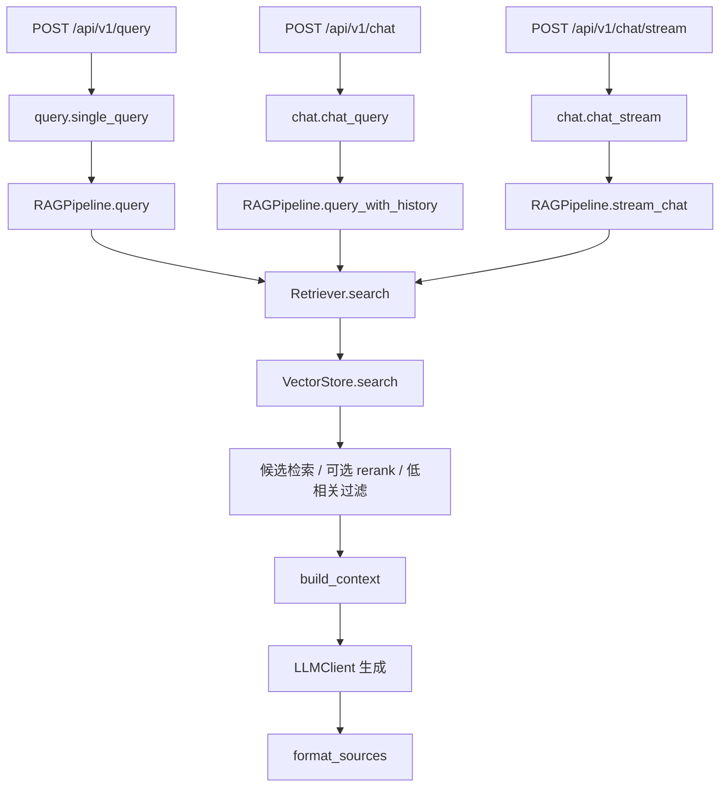
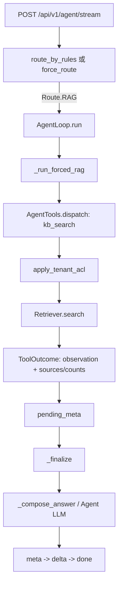

# RAG 模式与 Agent `forced RAG` 链路分析

> 本文基于当前仓库的 `backend/app/` 实现梳理。行号以本次分析时的代码为准；代码调整后请重新核对。

## 1. 结论概览

项目里存在两种“走 RAG”的执行方式：

1. **RAG 模式**：`/query`、`/chat`、`/chat/stream` 直接调用 `RAGPipeline`。检索、上下文构造、专用 RAG 提示词、答案生成和来源格式化均由这条管线负责。
2. **Agent forced RAG**：Agent 路由到 `Route.RAG`，或 Agent 执行中某些异常/边界触发回退时，调用 `_run_forced_rag()`。它将 `kb_search` 作为工具执行，检索仍复用 `Retriever`，之后 Agent 的收尾逻辑根据工具观察生成答案。

两条链路共享向量检索底层和租户/版本过滤能力，但不共享完整的回答生成管线。**检索能力复用，编排与生成路径不同。**

## 2. RAG 模式链路

### 2.1 入口与调用关系



`/query`、`/chat` 和 `/chat/stream` 分别在 `backend/app/api/v1/query.py:25`、`backend/app/api/v1/chat.py:37`、`backend/app/api/v1/chat.py:69` 进入管线。API 层解析 `top_k`，并通过 `enforced_filter()` 注入认证主体的租户过滤条件（`backend/app/api/deps.py:75`）。同步检索/生成由线程池执行，避免阻塞异步事件循环。

### 2.2 检索阶段

`RAGPipeline._retrieve()` 将请求交给 `Retriever.search()`（`backend/app/rag/pipeline.py:41`；`backend/app/rag/retriever.py:24`）。Retriever 是薄封装，返回 `(chunks, dropped)`；实际召回策略在 `VectorStore.search()`（`backend/app/vector/qdrant.py:297`）：

- 根据配置走 hybrid（dense + BM25，RRF 融合）或 dense vector 检索。
- 若启用 rerank，先扩大候选集，再精排取 `top_k`。
- 低相关过滤只对 rerank 的绝对分数启用，返回过滤掉的条数 `dropped`。
- 查询过滤条件包含可见文档版本：未版本化文档或当前发布版本；并叠加调用方的服务端过滤条件。

`Retriever.search()` 将过滤统计统一成 `dropped`，供响应及流事件展示。这里不应把 RRF 分数误当作可跨查询比较的绝对相关度。

### 2.3 三种管线接口的回答行为

| 接口 | 无检索结果 | 有检索结果 | 历史与流式 |
|---|---|---|---|
| `query()` | 直接返回“根据现有资料，未能找到相关信息。”，不调用生成模型 | `build_context()` + `SYSTEM_PROMPT` + 当前问题，调用 `llm.complete()` | 单轮，`generate=False` 可只检索 |
| `query_with_history()` | 构造“无相关参考资料”上下文，仍调用 `llm.complete()` | 同上，并把历史消息放在当前问题前 | 多轮非流式 |
| `stream_chat()` | 先发 `meta`，再发拒答 `delta` 和 `done`，不调用生成模型 | 先发 `meta`，然后逐段输出模型 `delta`，最后 `done` | 多轮 SSE；生成异常可发 `error` |

实现分别位于 `backend/app/rag/pipeline.py:49`、`:106`、`:144`。`build_context()` 将 chunk 编为“参考 N”，附带来源文件名、格式、页码/行号/Sheet 等信息（`backend/app/rag/context_builder.py:14`）；专用 RAG 系统提示词要求依据资料回答（`backend/app/prompts/rag.py:3`）。

对外来源由 `format_sources()` 生成，包括文件名、格式、分数、版本信息；`query()` 可以附 200 字预览，其它对话接口不附预览（`backend/app/rag/source_formatter.py:14`）。返回统计包括 `retrieved_count` 和 `hidden_count`。

## 3. Agent 模式中的 `run_forced_rag`

### 3.1 入口与调用关系



API 入口是 `backend/app/api/v1/agent.py:44`。默认先调用规则路由；请求可以通过 `force_route="rag"` 覆盖路由选择（Schema 约束仅允许 `rag|sql`，见 `backend/app/schemas/agent.py:12`）。Agent Loop 在 `backend/app/agent/loop.py:136` 产出 route 事件，`Route.RAG` 分支直接执行 `_run_forced_rag()` 后进入 `_finalize()`（`backend/app/agent/loop.py:174`）。

### 3.2 forced RAG 的执行细节

`_run_forced_rag()`（`backend/app/agent/loop.py:226`）执行顺序如下：

1. 发出 `tool_call` 事件，工具名为 `kb_search`。
2. 通过 `_exec_tool()` 分发到 `AgentTools.kb_search()`。
3. 工具调用 `apply_tenant_acl()` 后再调用共享 `Retriever.search()`（`backend/app/agent/tools.py:114`）。
4. 检索成功时构造 `ToolOutcome`：`observation` 是带来源的文本片段；`payload` 保存 chunks、sources、召回数和过滤数。
5. `_exec_tool()` 保存 `last_outcome`，并将标准 `meta` 暂存到 `pending_meta`（`backend/app/agent/loop.py:367`）。
6. `_finalize()` 先发暂存的 `meta`，再生成最终答案，最后输出 `delta` 和 `done`（`backend/app/agent/loop.py:453`）。

标准成功事件顺序为 `route -> tool_call -> tool_result -> meta -> delta -> done`。`/agent/stream` 通过 `iterate_in_threadpool()` 驱动同步 Agent 生成器，并将事件编码为 SSE（`backend/app/api/v1/agent.py:103`）。

### 3.3 Agent 如何生成答案

直接强制路由到 RAG 时，`_run_forced_rag()` 只做检索；最终答案由 `_finalize()` 的 `_compose_answer()` 生成（`backend/app/agent/loop.py:549`）：

- 读取 `state.forced_observation` 中的工具观察文本。
- 使用 Agent 专用 `SYSTEM_PROMPT` 与 `render_answer_prompt()` 请求模型简洁作答（`backend/app/prompts/agent.py:5`、`:37`）。
- 工具失败时直接返回工具错误观察；SQL 澄清结果优先直接返回。
- 最终生成失败时回退到观察文本，且截断到 2000 字。

因此 Agent forced RAG 并不会调用 `RAGPipeline.query()`，也不会使用 `build_context()` 和 `prompts/rag.py` 的系统提示词。它将检索 chunk 编成工具观察，交由 Agent 的最终回答模板处理。

### 3.4 Agent 自动工具循环中的 RAG 调用与降级

“forced RAG”不仅来自规则路由或 `force_route`，还在 Agent 工具循环中作为兜底执行。`_run_llm_loop()` 会在以下情况转入 `_run_forced_rag()`：

- 墙钟超时；
- Agent 工具选择模型调用次数达到上限；
- Agent 工具选择模型调用异常；
- 检测到重复工具调用且当前没有可用最终答案；
- 所有本轮工具都失败。

对应分支见 `backend/app/agent/loop.py:259` 起。注意有两种不完全相同的退出行为：

- `max_steps` 到达时，代码发出 `degraded(max_steps)`，随后直接进入 `_finalize()`，**当前实现没有在该分支调用 `_run_forced_rag()`**（`backend/app/agent/loop.py:358-360`）。若此前没有工具观察，最终答案可能是“无可用资料”的通用回答。不要把“达到所有上界都会检索兜底”当成当前实现事实。
- 自动工具循环已经成功调用 `kb_search` 时，模型通常先收到工具观察并可能自行给出最终答案；该路径不等价于“规则强路由 RAG 后再检索一次”。

## 4. 两条链路的联系

| 维度 | 共用点 |
|---|---|
| 检索入口 | 最终都通过 `Retriever.search()` 调 `VectorStore.search()` |
| 检索能力 | 共享 hybrid/vector、RRF、可选 rerank、低相关过滤和版本可见性 |
| 租户隔离 | 最终都将服务端租户约束叠加到检索 filter；经典路径通过 `enforced_filter()`，Agent 工具路径通过 `apply_tenant_acl()` |
| 来源与统计 | 都能把 chunks 格式化为 sources，并携带召回条数、隐藏条数等信息 |
| 服务实现 | 都是同步检索/模型调用，由异步 API 使用线程池适配，避免阻塞事件循环 |

租户过滤策略已集中到 `apply_tenant_acl()`（`backend/app/core/security.py:41`）：移除客户端提供的租户字段，再使用认证主体的 `tenant_id`。经典 API 用 `enforced_filter()` 薄封装该逻辑，Agent `kb_search()` 直接调用同一策略。这个共同入口很重要：历史上 Agent 漏传租户导致过跨租户检索；当前代码已将两边的策略统一。

## 5. 两条链路的区别

| 维度 | RAG 模式 | Agent forced RAG |
|---|---|---|
| 编排者 | `RAGPipeline` | `AgentLoop` + `AgentTools` |
| 主要入口 | `/query`、`/chat`、`/chat/stream` | `/agent/stream` |
| RAG 组件复用 | `Retriever`、`build_context`、`prompts/rag.py`、`format_sources` | 复用 `Retriever` 和 `format_sources`；不走 `build_context` / RAG 专用提示词 |
| 生成方式 | RAG 系统提示词直接把 context 与问题交给模型 | `kb_search` 的 observation 再交给 Agent 最终回答模板 |
| 无结果行为 | 单轮 `query` 和流式接口本地拒答；历史非流式仍调用模型 | 工具返回“未找到相关内容”，收尾阶段仍可能调用 Agent 模型组织答案 |
| 控制流 | 一次检索，然后一次生成；历史/流式由不同管线方法处理 | 先有规则路由；也可能有多工具循环、执行轨迹、降级事件及 Agent 收尾 |
| 事件/响应 | JSON 响应或经典 `meta/delta/done/error` | 增加 `route/tool_call/tool_result/degraded` 等 Agent 事件，再兼容 `meta/delta/done` |
| 历史上下文 | `query_with_history`/`stream_chat` 把聊天历史直接交给模型 | Agent Loop 额外保存 SQL 工具轨迹供后续追问；RAG 检索观察只在本轮工具执行时进入 Agent 模型上下文 |
| 来源预览 | `query()` 的 sources 可有 200 字预览 | `kb_search` 的 sources 不含预览；片段文本供 Agent 内部生成答案 |

## 6. 结构上的关键理解

可以将依赖关系理解为：

```text
                    ┌─ RAGPipeline ─ build_context ─ RAG prompt ─ LLM
VectorStore ← Retriever
                    └─ AgentTools.kb_search ─ observation ─ Agent prompt ─ LLM
```

`Retriever` 是两条链路真正的共享边界。Agent 并未把 `RAGPipeline` 当作子流程调用，而是复用其更底层的检索能力，再用 Agent 自己的工具协议、状态、事件和回答生成过程完成任务。这样可以保留 Agent 的路由/工具轨迹，同时避免复制一套向量检索实现；代价是两种模式的空结果处理、提示词、来源展示和生成细节并不完全一致。

## 7. 阅读代码的推荐顺序

1. `backend/app/api/v1/query.py` 与 `backend/app/api/v1/chat.py`：经典 RAG API 入口。
2. `backend/app/rag/pipeline.py`：三种 RAG 管线接口及其分支行为。
3. `backend/app/rag/retriever.py`、`backend/app/vector/qdrant.py`：检索封装与实际召回策略。
4. `backend/app/api/v1/agent.py`：Agent API、规则路由与事件流。
5. `backend/app/agent/loop.py`：强制路由、工具循环、降级和最终回答。
6. `backend/app/agent/tools.py`：`kb_search` 与租户过滤、工具观察格式。
7. `backend/app/prompts/rag.py`、`backend/app/prompts/agent.py`：两套提示词和回答指令。

## 8. 总结

RAG 模式是一条专用问答管线：检索后构造带编号和出处的 context，由 RAG prompt 直接生成答案。Agent forced RAG 是 Agent 的一种工具执行路径：通过 `kb_search` 复用相同检索器，将检索结果转换为工具 observation，再由 Agent 的最终回答逻辑生成答案。二者的底层召回、过滤与租户隔离能力相通，编排边界、上下文格式、提示词、空结果行为和 SSE 事件则各自独立。
