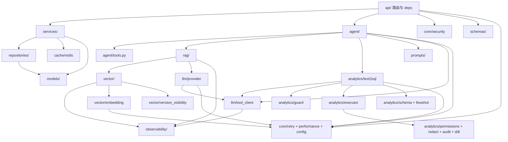

# 09 · 依赖关系与数据流

## 1. 包间依赖（后端 `app/` 内部）

依赖方向自上而下，箭头表示“被谁 import”：



要点：

- **入口依赖**：`api/` 只依赖 service/agent/schema/security（成本看板直接调 `observability/usage`），不直接碰 vector/analytics 内部实现。
- **Agent 复用 RAG**：`tools.kb_search` 只依赖 `Retriever.search`（唯一接触点），复用全部检索能力。
- **Agent 复用 Text2SQL**：`sql_query` 走 `guard_and_record + executor.execute`；`sql_answer` 走 `Text2SqlEngine.answer`。
- **用量记账归可观测层**：`llm/tool_client.py` 每次 tool-calling 调用后写 `observability/usage`（写入失败不阻断问答）；`provider.py` 只从响应提取 usage、不落库。因此 `llm/` **不反向依赖 `analytics/`**。
- **核心工具下沉**：metrics/retry/performance/trace/config 被所有层依赖，是最底层。
- **模型注册**：`models/__init__.py` re-export 全部模型供 Alembic 与 `create_all` 注册。

## 2. 外部依赖（`backend/pyproject.toml`）

| 类别 | 依赖 |
| --- | --- |
| Web/ASGI | fastapi、uvicorn[standard]、python-multipart |
| 配置/校验 | pydantic、pydantic-settings、python-dotenv |
| HTTP | httpx、requests |
| 向量库 | qdrant-client |
| 文档解析 | pymupdf、python-docx、openpyxl、pandas、pdfplumber、jieba |
| 持久化 | sqlalchemy[asyncio]、asyncpg、psycopg[binary]、alembic |
| 缓存/队列 | redis、arq |
| SQL 安全 | sqlglot（AST 白名单、LIMIT 注入、标识符转义） |
| 可观测 | langfuse |

开发依赖（`[dependency-groups].dev`）：pytest、pytest-asyncio。

前端（`frontend/package.json`）：运行时 `vue/pinia/markdown-it`；开发 `typescript/vite/@vitejs/plugin-vue/vue-tsc/@types/markdown-it`。

## 3. 数据流

### 3.1 RAG 问答数据流

```
问题 → resolve_principal(租户/角色)
  → RAGPipeline.query/stream_chat
    → Retriever.search(apply_tenant_acl 过滤)
      → VectorStore.search: embedding → hybrid/vector → rerank → 低相关过滤
    → build_context → LLMClient.complete/stream
  → format_sources → {answer, sources, retrieved_count, hidden_count}
```

### 3.2 Text2SQL 数据流

```
问题 → detect_ambiguity(口径)
  → load_table_schemas(租户) → filter_sensitive_columns → select_relevant_schema_text
  → fewshot.retrieve
  → ToolLLMClient.chat_with_tools(SQL_TOOLS)
  → guard_and_record(改写+LIMIT)
  → SqlExecutor.execute(explain 预检 → 只读事务 + RLS + 脱敏 + 审计)
  → Text2SqlResult → summarize → answer
```

### 3.3 文档入库数据流

```
上传 → 落盘 .versions/ → Document(pending) + IngestTask(queued) → ARQ enqueue
  → worker ingest_document/ingest_version
    → process_file: 清旧向量 → loader 解析 → chunking → embedding → upsert(Qdrant)
    → (可选) sync_analytics_tables: schema_infer → ddl 建表 → COPY 装载 → 写元数据
    → publish(版本) / 任务 done
```

### 3.4 会话数据流

```
请求带 session_id → SessionService.get_history(Redis 命中 → 返回 / miss → PG 回源 → reheat)
  → 流式完成 → SessionService.append(user/assistant + tool_context，写 PG + 缓存)
```

## 4. 关键不变量

| 不变量 | 保证 |
| --- | --- |
| 检索租户过滤单入口 | `apply_tenant_acl`，经典 RAG 与 Agent 同用 |
| SQL 租户身份单入口 | `resolve_tenant_identity`，保留值一律按匿名 |
| LIMIT 注入与执行读取同步 | `GUARD_LIMIT == max_rows + 1`，单测锁死 |
| 只读角色快路径 | `redact` 空集即 `analyst`，零成本跳过脱敏/受限引擎 |
| 版本发布串行 | `pg_advisory_xact_lock(document_key)` |
| 当前版本唯一 | 部分唯一索引 `uq_documents_current_key` |