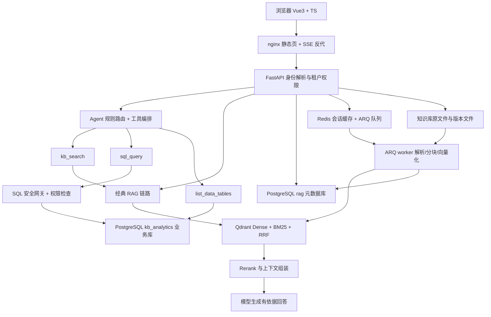

# Code Wiki —— 企业知识库问答 Agent（RAG + Text2SQL）

> 本目录是对 `personal_rag` 仓库的**结构化代码文档**，覆盖整体架构、模块职责、关键类与函数、依赖关系与运行方式。所有路径均以仓库根目录 `d:\PythonProjects\personal_rag` 为基准，代码引用使用 `file:///` 可点击链接。

## 项目是什么

面向企业内部文档与业务数据的**多租户问答助手**，双引擎：

- **RAG 引擎**：回答“政策/合同/规格/流程”等非结构化文档问题，附带引用来源。
- **Text2SQL 引擎**：回答“人数/金额/排名”等全量精确统计问题，通过只读 SQL 交给数据库计算。

Agent 把两者组合：规则前置路由 → 三个工具（`kb_search` / `sql_query` / `list_data_tables`）→ 有界状态机编排 → SSE 流式输出答案与执行轨迹。

技术栈：Python 3.12+ · FastAPI · Vue 3 · TypeScript · Pinia · PostgreSQL · Qdrant · Redis · ARQ · SQLAlchemy · Alembic · sqlglot · Docker Compose · nginx。

## 系统架构总览



两个 PostgreSQL 数据库：`rag`（应用元数据）与 `kb_analytics`（业务数据），默认部署在同一实例、物理隔离到不同库与不同只读账号。

## 核心请求链路

**在线问答**：解析 `X-API-Key`/`Bearer` 取租户与角色 → 规则路由判断走 RAG/SQL/LLM → 检索与 SQL 各自执行权限约束 → 工具返回证据或结果 → Agent 生成答案 → SSE 推送来源、工具轨迹、答案 → 会话与有限工具上下文持久化。

**文档入库**：上传接口保存不可变版本文件 → 登记文档与任务并入队 ARQ → worker 解析/分块/Embedding/写向量 → 完整写入成功后发布 → 检索只读已发布版本。

## 文档导航

| 文档 | 内容 |
| --- | --- |
| [01-项目概览与架构](01-项目概览与架构.md) | 技术栈、设计亮点、核心链路、功能边界 |
| [02-关键类与函数](02-关键类与函数.md) | 后端各包的关键类/函数职责速查（最全参考） |
| [03-API-鉴权与多租户](03-API-鉴权与多租户.md) | 路由表、身份解析、租户 ACL、RBAC、RLS |
| [04-Agent编排与RAG链路](04-Agent编排与RAG链路.md) | Agent 状态机、规则路由、工具、SSE 事件、混合检索 |
| [05-Text2SQL与SQL安全](05-Text2SQL与SQL安全.md) | NL→SQL 引擎与四层 SQL 防御、脱敏、审计 |
| [06-文档解析-入库与版本管理](06-文档解析-入库与版本管理.md) | 多格式解析、分块、向量化、ARQ 任务、版本发布/回滚 |
| [07-数据模型-仓储与服务](07-数据模型-仓储与服务.md) | ORM 模型、仓储、服务、Redis 缓存、DB 层 |
| [08-前端架构](08-前端架构.md) | Vue 组件、Pinia store、SSE 客户端、事件类型 |
| [09-依赖关系与数据流](09-依赖关系与数据流.md) | 包间依赖、外部依赖、数据流汇总 |
| [10-运行-部署-测试与评测](10-运行-部署-测试与评测.md) | 启动命令、Docker、迁移、pytest、评测工具 |

## 目录骨架速查

```text
backend/app/
├── api/            # FastAPI 路由与依赖注入（v1/*）
├── agent/          # 规则路由、工具、状态机、SSE 事件
├── rag/            # 检索封装、上下文、来源格式
├── vector/         # Qdrant 混合检索、Embedding、版本可见性
├── ingestion/      # 文件解析、分块、索引
├── worker/         # ARQ 配置与后台入库任务
├── analytics/      # Text2SQL、安全、权限、ETL、审计、恢复
├── services/       # 会话与入库业务服务
├── repositories/   # 数据访问与版本登记
├── models/         # SQLAlchemy 数据模型
├── core/           # 配置、安全、重试、日志、指标、性能采集、trace
├── llm/            # LLM/Embedding/Rerank 网关 + 工具调用客户端
├── prompts/        # 提示词与 few-shot 示例
├── schemas/        # Pydantic 请求/响应模型
└── observability/  # Langfuse 软集成
frontend/src/
├── api/            # HTTP/SSE 客户端与类型
├── stores/         # Pinia 会话状态
└── components/     # 聊天、引用、轨迹、上传与版本管理
```

源码主入口：[main.py](file:///d:/PythonProjects/personal_rag/backend/app/main.py)（`create_app()` 应用工厂）；工作进程入口：[worker/settings.py](file:///d:/PythonProjects/personal_rag/backend/app/worker/settings.py)。