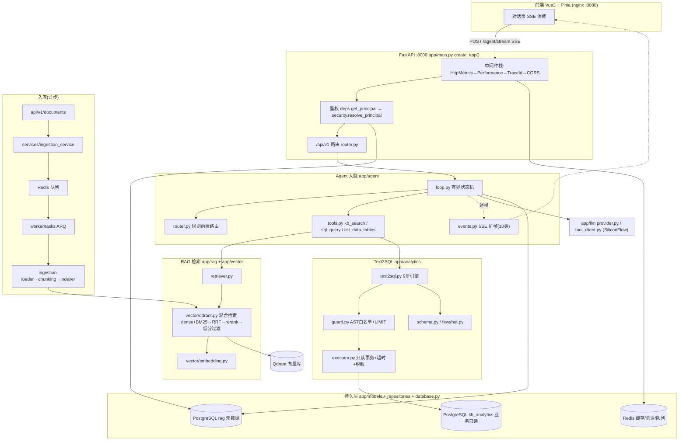

# 对话问答主链路 · 架构图与逐行走读

> 面向"刚接手项目"的读者。先给架构与调用链时序图，再按请求流经顺序逐段走读代码，
> 标注**文件 + 行号**（行号基于当前 `main` 分支实现，最后核对 2026-11-11；再次重构后以仓库最新为准）。
>
> 相关入口：`backend/app/api/v1/agent.py`（SSE 主入口）、`backend/app/agent/loop.py`（有界状态机）。

---

## ① 架构与调用链图

### 1.1 组件全景（分层 + 外部依赖）



### 1.2 对话问答调用链时序图（含三条执行路径）

```mermaid
sequenceDiagram
    autonumber
    participant FE as 前端
    participant API as api/v1/agent.py
    participant SEC as security(鉴权)
    participant SSESS as SessionService(sessions表)
    participant ROUTE as router.py(规则)
    participant LOOP as loop.py(Agent状态机)
    participant TOOL as tools.py
    participant RET as retriever→qdrant
    participant T2S as text2sql引擎
    participant LLM as llm(SiliconFlow)

    FE->>API: POST /agent/stream (X-API-Key)
    API->>SEC: resolve_principal → Principal(tenant_id, role)
    API->>SSESS: 复用/新建 session + 存 user 消息 + 取 history
    API->>ROUTE: route_by_rules(message) 先算一次
    API->>LOOP: run(msg, tenant_id, history, redact, actor) [同步生成器→线程池桥接]
    LOOP-->>FE: event: route(target, reason)

    alt 强路由 SQL (聚合词+列名同时命中)
        LOOP->>TOOL: list_data_tables()
        TOOL->>T2S: answer(question) [schema linking→fewshot→生成→guard→explain→执行→自修正]
        T2S-->>LOOP: Text2SqlResult(sql, rows...)
        LOOP-->>FE: tool_call→tool_result→sql
    else 强路由 RAG (命中文档词)
        LOOP->>TOOL: kb_search(question, tenant_id)
        TOOL->>RET: search(query, filter=apply_tenant_acl)
        RET-->>TOOL: (chunks, dropped)
        LOOP-->>FE: tool_call→tool_result
        LOOP->>LLM: 用 observation 生成答案(_compose_answer)
    else 交 LLM 决策 (无强信号)
        LOOP->>LLM: chat_with_tools(messages, TOOLS)
        LLM-->>LOOP: tool_calls? 选 kb_search/sql_query
        LOOP->>TOOL: dispatch(name, args, tenant_id, redact, actor)
        TOOL-->>LOOP: ToolOutcome(observation)
        LOOP->>LLM: 回灌 role=tool 继续下一轮 (≤MAX_STEPS)
    end

    Note over LOOP: 任一步失败/超时/超步数 → 降级为纯 RAG(必补 meta 帧)
    LOOP-->>FE: event: meta(sources, hidden) 若有检索
    LOOP-->>FE: event: delta(答案文本)
    LOOP-->>FE: event: done(answer, agent_stats, _tool_context)
    API->>SSESS: 落 assistant 消息(content + tool_context 供下轮追问)
```

### 1.3 SSE 事件契约（前端/评测的稳定协议，见 `agent/events.py`）

`route → [tool_call → tool_result → sql?] … → [meta]? → delta → done`，
异常追加 `error`，降级插入 `degraded`。

---

## ② 对话问答主链路 · 逐段代码走读

### Stage 0 · 鉴权与身份（贯穿全链的安全底座）
文件：`backend/app/core/security.py`

- `resolve_principal()` **L129-167**：从 `X-API-Key`/`Bearer` 解析租户。**软关闭**：未配
  `RAG_TENANT_KEYS` 时返回匿名主体 `tenant_id=None`（L138-141）；缺 Key→401（L151），
  Key 无效→403（L155）；角色来自 `RAG_TENANT_ROLES`，配了未知角色**显式报错**而非静默降级
  （L159-165，防笔误变权限漏洞）。
- `Principal.redact_columns()` **L119-126**：analyst→空集（零成本快路径），
  employee→敏感列集合（供 RBAC 脱敏）。
- `apply_tenant_acl()` **L41-83**：**唯一**的租户过滤构造入口。注释 L47-61 记录了一次真实
  跨租户泄露——因为过滤逻辑曾有两份实现、Agent 那条漏传 `tenant_id`。核心语义：
  **客户端/模型传的租户键一律丢弃**（L79），只认服务端主体。

> 上手要点：读任何数据路径，先问"这里 `apply_tenant_acl`/`tenant_id` 在哪"。

### Stage 1 · API 入口
文件：`backend/app/api/v1/agent.py`

- `agent_stream()` **L59-138**：主入口。
  - L70-73 复用/新建 session，并**先把 user 消息落库**（会话存 `sessions/messages` 表，故 Agent 也能多轮）。
  - L77 在**路由层**先算一次 `route_by_rules`（便于透传 + 统计）。
  - L89-90 把 RBAC 收敛成 `redact`/`actor` 两个值传进 Loop。
  - L95-102 调 `loop.run(...)` —— 它是**同步生成器**（内部要调同步的 Retriever/SQL 执行器）。
  - L104-124 `event_gen()`：用 `iterate_in_threadpool`（L107）把同步生成器桥接进异步 SSE，
    **事件循环不被阻塞**。收到 `done` 帧时（L109-122）把答案 + `_tool_context`（本轮 SQL 轨迹）落库，
    并回填 `session_id`/`history_length` 给前端续聊。
  - L130-138 响应头 `X-Accel-Buffering: no`（L135）——**告诉 nginx 别缓冲，逐帧透传**，SSE 实时性关键。

### Stage 2 · 规则前置路由（三层路由第一层，纯函数可穷举单测）
文件：`backend/app/agent/router.py`

- `route_by_rules()` **L107-169**，判定优先级（顺序即优先级）：
  1. 命中**文档词**且未同时构成"聚合 + 列名"→ `RAG`（L136-143）
  2. **聚合词 与 列名词同时**命中 → 强路由 `SQL`（L146-152）
  3. 仅命中列名词 → `LLM_DECIDE`（L155-161）
  4. 无信号 → `LLM_DECIDE`（L164-169）
- ⚠️ 最关键设计（文件头 L17-20）：**必须同时命中聚合词与已注册列名才走 SQL**。
  反例"布洛芬最多多久吃一次"——"最多"是聚合词但"多久"命中 DOC 词，正确判为 RAG。
  词表见 `AGGREGATION_WORDS L59-67`、`DOC_WORDS L70-79`、`DEFAULT_COLUMN_WORDS L83-97`。
- `build_column_words()` **L172-189**：从表 schema 的中文描述动态扩词，让规则层随 schema 自动演进。

### Stage 3 · Agent Loop（有界状态机，核心大脑）
文件：`backend/app/agent/loop.py`

- **五重防死循环**（文件头 L9-14 + 常量 L43-46）：`MAX_STEPS=5`、`WALL_CLOCK=60s`、
  `MAX_LLM_CALLS=8`、相同工具 + 参数去重、任一步失败降级纯 RAG。
- `AgentState` **L76-106**：显式状态机，把 `redact/actor` 放这里避免 8 个方法签名逐层传参漏传（L95-97）。
- `run()` **L135**：主入口。先 yield `route` 帧（L166），再按路由分三条路径：
  - `Route.SQL` → `_run_forced_sql()` **L184**：0 成本直连，先 `list_data_tables` 再走 Text2SQL 引擎，
    并把成功 SQL + 结果记进轨迹（供下轮追问）。
  - `Route.RAG` → `_run_forced_rag()` **L226**。
  - `LLM_DECIDE` → `_run_llm_loop()` **L268-360**：模型自主选工具的有界循环。
- `build_messages()` **L237**：把 system + 最近 6 轮历史 + 本轮问题拼成 messages。
  **多轮缺陷修复**（L249-263）：把上一轮的 `[工具执行记录]`（执行过的 SQL + 结果行）注入 assistant 消息，
  模型才看得到“1042 怎么来的”，能直接做加法。用“系统注记”而非伪造 `role=tool`（避免缺配对 id 被上游拒）。
- `_run_llm_loop()` 细节 **L268-360**：每轮先查墙钟与 LLM 调用上界（L275-284）→ `chat_with_tools`（L290）→
  无 tool_calls 即结束（L299-301）→ **去重保护**（L308-318）→ 执行工具并以
  `role=assistant(tool_calls)+role=tool` 回灌（L336-349）→ 全部工具失败则降级 RAG（L351-356）；步数用尽在 L358-360。
- `_finalize()` **L453**：**先补发 `meta` 帧**（若 kb_search 执行过，否则前端来源列表/徽标永久空白），
  再 `delta`+`done`。
- `_compose_answer()` **L549**：用模型把工具观察渲染成答案；成本上界已到就**直接回观察文本**保证有答案。
- `build_tool_context()` **L482** 与 `MAX_TRACE_ROWS=5`（L52）：只留最后一条 SQL、少量结果行，
  因为该文本进**每一轮** prompt，全量会 token 爆炸。
- `_record_metrics()` **L521**：同时记 `steps` 与 `tool_calls`——强路由路径不进 LLM 循环 `steps` 恒 0，
  只看 steps 会误判“啥也没干”。

### Stage 4 · 工具层（Loop 与世界的接触面）
文件：`backend/app/agent/tools.py`

- 三个工具的 schema `TOOLS` 现位于 **`backend/app/prompts/agent.py` L68**（提示词与工具描述同源维护）；`loop.py` L34-39 从这里导入。
- `kb_search()` **L114**：**复用现成 Retriever，零新增检索逻辑**。内部强制走 `apply_tenant_acl`
  （注释记录真实泄露根因）；返回 `(chunks, dropped)` 与 pipeline 同构，好让上层补 `meta`；
  observation 拼成 `[i]（来源：…）正文`。
- `sql_query()` **L195**：执行**模型直接写好的 SQL**，走 `guard_and_record` +
  `get_executor().execute`（带 tenant/redact/actor）。与 `sql_answer` 区别：这里不做 NL→SQL 二次翻译。
- `sql_answer()` **L251**：把自然语言交给 Text2SQL 引擎，**session 生命周期收在这层**，
  Loop 只依赖工具契约 → 可 hermetic 测试。
- `dispatch()` **L303**：统一分发，注意 kb_search 分支强制透传 `tenant_id`。
- `describe_exception()` **L30**：沿异常链找根因（曾把 embedding 504 误报成 generator 异常，误导排查）。

### Stage 5 · RAG 检索底层
- `backend/app/rag/retriever.py` `search()` **L26-34**：薄封装，把 `(results, stats)` 收敛成 `(chunks, dropped)`。
- `backend/app/vector/qdrant.py` `search()` **L297-382**（真正干活的读路径）：
  - L312-324 组装过滤：**版本可见性**（未设版本或版本在 `current_revision_ids()` 里）+ 上层 `filter_dict`（含租户）。
  - L330 开精排时多召回候选；L332-342 按 `retrieval_mode` 走 `_hybrid_query()`（dense+BM25 各 `prefetch_k`→RRF）或纯向量。
  - L351-367 rerank 精排 + **低相关过滤**（`_filter_low_relevance`，产出 `dropped` 供"已隐藏 N 条"）；精排 API 异常自动降级原始顺序。
- 写路径对照 `upsert_chunks()` **L240-295**：每点写**双通道** `dense`+`bm25`（L270-276），
  这是集合结构为 `personal_rag_v2` named vectors 的原因（旧单向量结构不兼容）。

### Stage 6 · Text2SQL 引擎（SQL 分支的完整链路）
文件：`backend/app/analytics/text2sql.py`，文件头 **L1-25** 画出 **9 步**：
Schema Linking → Few-shot 检索 → **口径歧义检查**(反问不猜) → LLM 生成(function calling) →
guard 校验 → EXPLAIN 预检 → 只读执行 → **失败把 DB 报错回灌重写**(≤`sql_max_retry`) → 渲染答案。

- 生成用**两个工具** `sql_query` + `ask_clarification`（`SQL_TOOLS` **L127 起**），把“反问”做成显式动作以便统计/评测/前端专门渲染。
- `answer()` **L178** 编排上述步骤，L273 `guard_and_record`、L284 执行；`needs_clarification` 透传回 Loop
  （Stage 3 `_exec_sql_via_engine` L388）。
- 歧义词表设计教训（`AMBIGUOUS_METRICS` **L62**）：**宁可漏问也不误问**，“Sales 部门平均薪资”口径已明确就不拦。

### Stage 7 · 多轮延续（回到 API 层）
`done` 帧带 `_tool_context` 回到 `api/v1/agent.py` **L109-122**，assistant 消息把答案(`content`)与
工具轨迹(`tool_context`)**分开存**：前者给前端渲染，后者只喂模型。下一轮 `build_messages` 把它注回 prompt，闭环形成。

---

## 建议阅读节奏
1. 先看 `api/v1/agent.py` + `loop.py` 建立"骨架 + 五重保护 + 三路径"心智；
2. 再挑**一条分支**深入：RAG 看 `tools.kb_search→retriever→qdrant.search`；
   SQL 看 `tools.sql_answer→text2sql.answer→guard/executor`；
3. 全程带一个安全问题："tenant_id 在这一层是否还在？"（答案几乎总在 `apply_tenant_acl`）。
